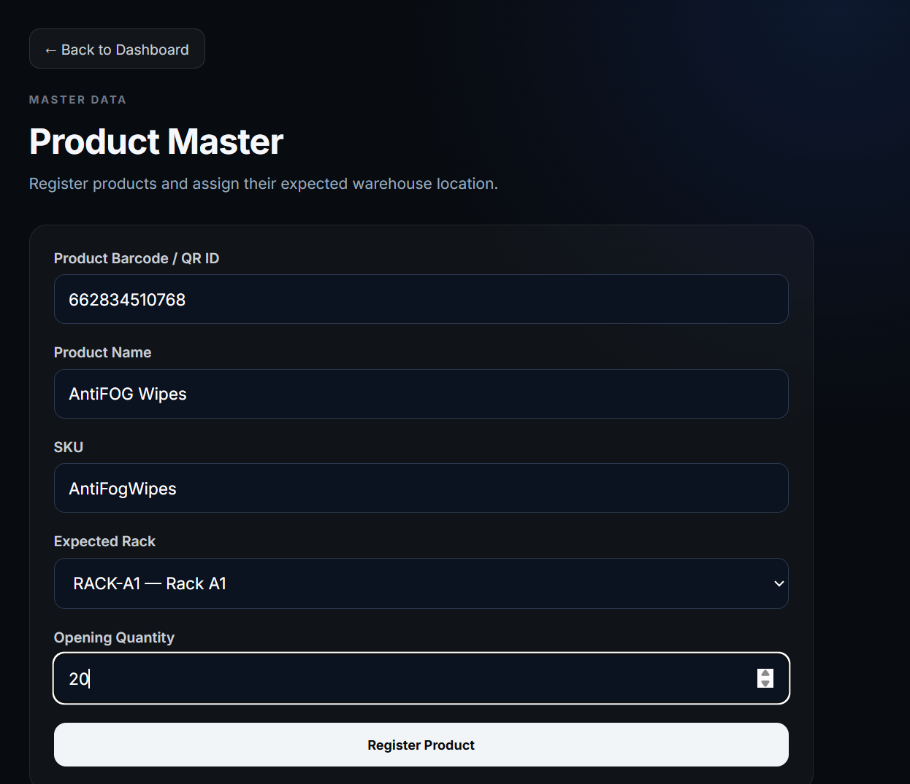
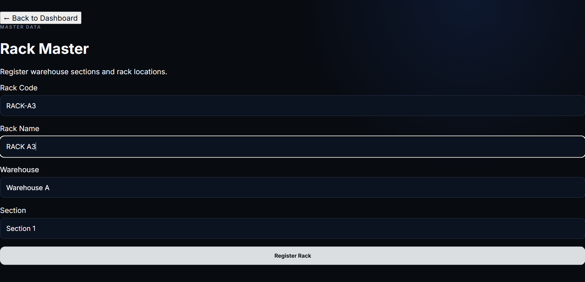
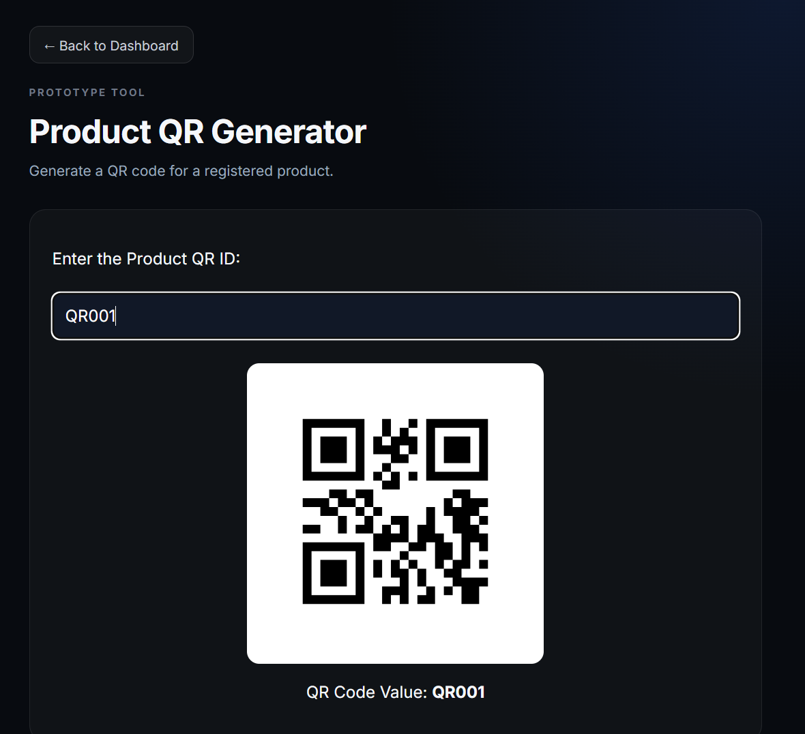
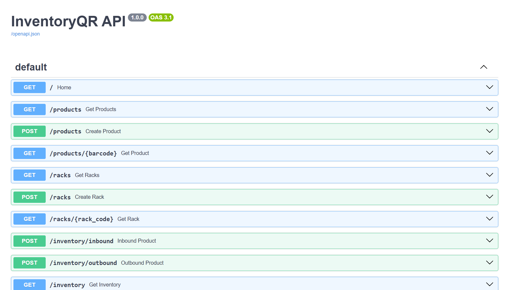

# InventoryQR

A QR-based warehouse inventory prototype. Scan a product, then scan the rack you are putting it on. The system checks that the product is going to the rack it is assigned to, updates the stock and records every movement.

## Screenshots

### Dashboard


### Product master


### Rack master


### QR generation


### Scan product


### Inventory and movement history


### API documentation


## Features

- **Product master.** Register products with a barcode, name, SKU, assigned rack and opening quantity.
- **Rack master.** Register racks with a rack code, name, warehouse and section.
- **QR generation.** Create QR codes for products and for racks, ready to print and stick on.
- **Scan in (inbound).** Scan the product, then scan the rack. The app only accepts the product on its assigned rack; any other rack is rejected with a message saying where it belongs.
- **Scan out (outbound).** Scan the product and enter a quantity. Stock is checked, so you cannot remove more than is available.
- **Inventory and history.** See current stock, each product's rack location and a movement history with local-time timestamps.
- **Camera scanning in the browser.** Reads QR codes and common barcodes (UPC-A, UPC-E, EAN-13, EAN-8, Code 128, Code 39, ITF).

## How it works

1. Add your racks (**Rack Master**) and products (**Product Master**).
2. Generate and print the QR codes for racks and products.
3. **Scan in:** scan a product, then the rack it is being stored on. A wrong rack is rejected.
4. **Scan out:** scan a product and enter how many are leaving.
5. Open **Inventory** to see stock, locations and the movement history.

## Tech stack

- **Backend:** Python, FastAPI, SQLAlchemy, SQLite, Uvicorn
- **Frontend:** React 19, Vite, html5-qrcode (scanning), qrcode.react (QR generation)

## Project structure

```
backend/
  main.py              API endpoints and business rules
  models.py            Product, Rack and Movement tables
  database.py          SQLite connection
  seed_demo_data.py    optional demo data, created through the real API
  requirements.txt
frontend/
  src/pages/           Home, Product Master, Rack Master, Generate QR, Scan Product, Scan Rack, Scan Out, Inventory
  src/services/        API client
docs/                  screenshots
run-backend.bat        Windows shortcut: start the backend
run-frontend.bat       Windows shortcut: start the frontend
seed-demo-data.bat     Windows shortcut: add demo data
```

## Getting started

You need Python 3.10+ and Node.js. Use two terminals (or double-click the three `.bat` files on Windows).

### 1. Backend

```bash
cd backend
python -m venv venv
# Windows:        venv\Scripts\activate
# macOS / Linux:  source venv/bin/activate
pip install -r requirements.txt
uvicorn main:app --reload
```

The API runs at http://127.0.0.1:8000 and its interactive docs are at http://127.0.0.1:8000/docs. The SQLite database (`backend/inventory.db`) is created automatically on first start.

### 2. Frontend

```bash
cd frontend
npm install
npm run dev
```

Open http://localhost:5173. Start the backend first.

### 3. Demo data (optional)

With the backend running, fill the app with sample racks, products and stock movements:

```bash
cd backend
python seed_demo_data.py
```

It is safe to run twice.

### Configuration

The frontend talks to `http://127.0.0.1:8000` by default. To use a different backend address, copy `frontend/.env.example` to `frontend/.env` and change `VITE_API_BASE_URL`.

## Try it

1. Run the demo data script, or add a rack and a product by hand in **Rack Master** and **Product Master**.
2. Open **Generate QR** to create QR codes for a product and a rack.
3. Open **Scan Product** and scan the product, then scan its rack (or type the codes if you have no camera). The stock goes up and the movement is recorded.
4. Try storing the same product on a different rack. It is rejected and the correct rack is shown.
5. Open **Scan Out**, remove some stock, then open **Inventory** to see the new stock and the history.

## API

| Method | Endpoint | Description |
| --- | --- | --- |
| GET | `/products` | List products |
| GET | `/products/{barcode}` | Get one product |
| POST | `/products` | Register a product (the rack must exist) |
| GET | `/racks` | List racks |
| GET | `/racks/{rack_code}` | Get one rack |
| POST | `/racks` | Register a rack |
| POST | `/inventory/inbound` | Store a product on a rack (`barcode`, `rack_code`, `quantity`) |
| POST | `/inventory/outbound` | Dispatch a product (`barcode`, `quantity`) |
| GET | `/inventory` | Current stock |
| GET | `/movements` | Movement history, newest first |

## Limitations

- This is a prototype for a single warehouse: there is no login and no user roles.
- Browsers only allow camera access on `localhost` or over HTTPS. To scan with a phone, serve the app over HTTPS (for example with a tunnelling tool) and set `VITE_API_BASE_URL` to an HTTPS address for the backend.
- CORS is open to every origin, which is fine for local use but should be restricted before any deployment.
- Movements record the product, type, rack and time, but not the quantity moved.
- SQLite is used for simplicity. A multi-user deployment would need a server database such as PostgreSQL.

## Author

Built by **Riya Patkar** ([@riyax11](https://github.com/riyax11)).
