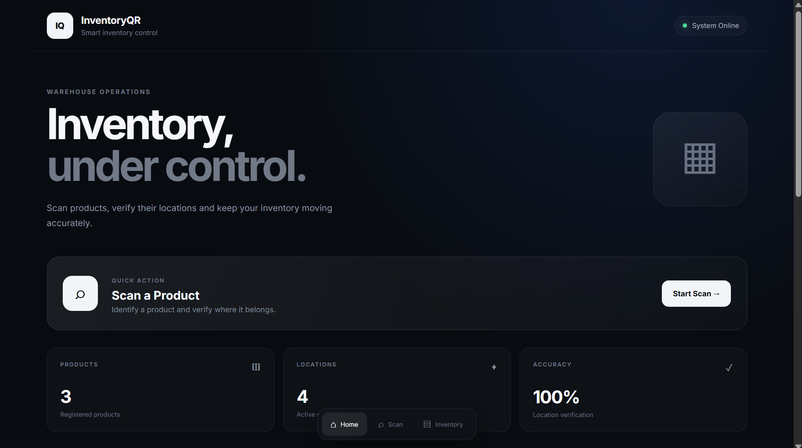
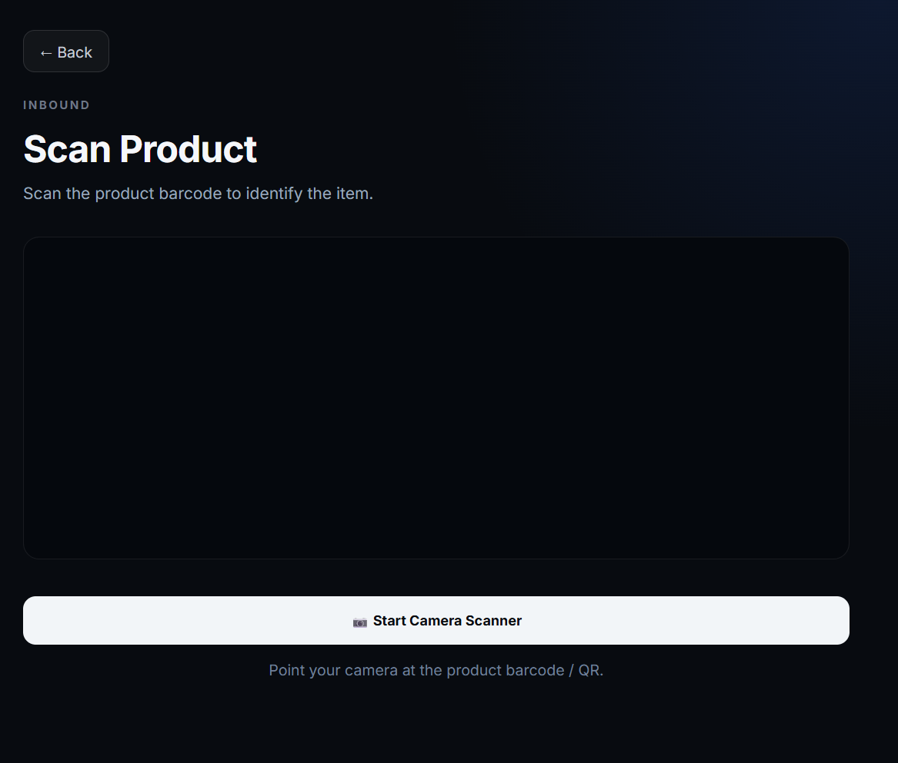
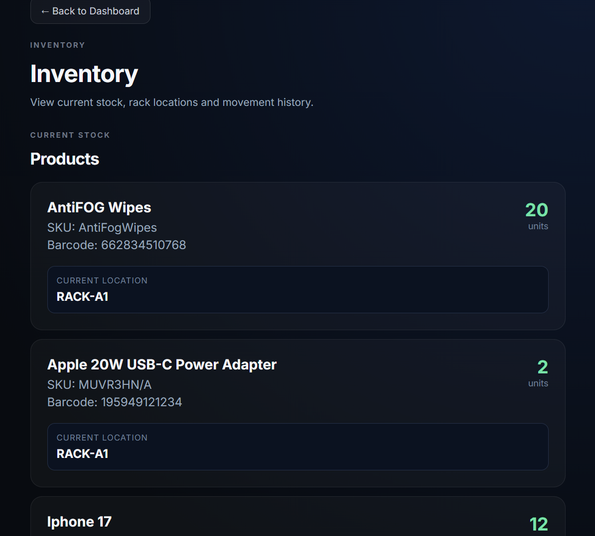

# InventoryQR

A QR-based warehouse inventory prototype. Scan a product, then scan the rack you are putting it on. The system checks that the product is going to the rack it is assigned to, updates the stock and records every movement.

<!-- Add screenshots here after uploading them to the repo, for example:



-->

## Features

- **Product master.** Register products with a barcode, name, SKU, assigned rack and starting quantity.
- **Rack master.** Register racks with a rack code, name, warehouse and section.
- **QR generation.** Create QR codes for products and for racks, ready to print and stick on.
- **Scan in (inbound).** Scan the product, then scan the rack. The app only accepts the product on its assigned rack; any other rack is rejected with a message saying where it belongs.
- **Scan out (outbound).** Scan the product and enter a quantity. Stock is checked, so you cannot remove more than is available.
- **Inventory and history.** See current stock, each product's rack location and a movement history with timestamps.
- **Camera scanning in the browser.** Reads QR codes and common barcodes (UPC-A, UPC-E, EAN-13, EAN-8, Code 128, Code 39, ITF).

## How it works

1. Add your racks (**Rack Master**) and products (**Product Master**).
2. Generate and print the QR codes for racks and products (**QR Management**).
3. **Scan in:** scan a product, then the rack it is being stored on. A wrong rack is rejected.
4. **Scan out:** scan a product and enter how many are leaving.
5. Open **Inventory** to see stock, locations and the movement history.

## Tech stack

- **Backend:** Python, FastAPI, SQLAlchemy, SQLite, Uvicorn
- **Frontend:** React 19, Vite, html5-qrcode (scanning), qrcode.react (QR generation)

## Project structure

```
backend/
  main.py            API endpoints and business rules
  models.py          Product, Rack and Movement tables
  database.py        SQLite connection
  requirements.txt
frontend/
  src/pages/         Home, Product Master, Rack Master, Generate QR, Scan Product, Scan Rack, Scan Out, Inventory
  src/services/      API client
```

## Getting started

You need Python 3.10+ and Node.js. Use two terminals.

### 1. Backend

```bash
cd backend
python -m venv venv
# Windows:        venv\Scripts\activate
# macOS / Linux:  source venv/bin/activate
pip install -r requirements.txt
uvicorn main:app --reload
```

The API runs at http://127.0.0.1:8000 and its interactive docs are at http://127.0.0.1:8000/docs. The SQLite database (`inventory.db`) is created automatically on first start.

### 2. Frontend

```bash
cd frontend
npm install
npm run dev
```

Open http://localhost:5173.

The frontend talks to `http://127.0.0.1:8000` (set in `frontend/src/services/api.js`). Start the backend first.

## Try it

1. Open **Rack Master** and add a rack, for example code `RACK-A1`, name `Rack A1`, warehouse `Warehouse A`, section `Section 1`.
2. Open **Product Master** and add a product, for example barcode `890000000003`, name `Lays Classic 50g`, SKU `LAYS50`, rack `RACK-A1`.
3. Open **QR Management** to create QR codes for the product and the rack.
4. Use **Scan Product**, then scan the rack QR (or type the codes if you have no camera). The stock goes up and the movement is recorded.
5. Try storing the product on a different rack. It is rejected with the correct rack shown.
6. Use **Scan Out** to remove some stock, then open **Inventory** to see the result.

## API

| Method | Endpoint | Description |
| --- | --- | --- |
| GET | `/products` | List products |
| GET | `/products/{barcode}` | Get one product |
| POST | `/products` | Register a product (the rack must exist) |
| GET | `/racks` | List racks |
| GET | `/racks/{rack_code}` | Get one rack |
| POST | `/racks` | Register a rack |
| POST | `/inventory/inbound` | Store a product on a rack (`barcode`, `rack_code`, `quantity`) |
| POST | `/inventory/outbound` | Dispatch a product (`barcode`, `quantity`) |
| GET | `/inventory` | Current stock |
| GET | `/movements` | Movement history, newest first |

## Limitations

- This is a prototype for a single warehouse: there is no login and no user roles.
- Browsers only allow camera access on `localhost` or over HTTPS. To scan with a phone, serve the app over HTTPS (for example with a tunnelling tool) and point `API_BASE_URL` in `frontend/src/services/api.js` at your backend.
- CORS is open to every origin and the API URL is hard-coded, which is fine for local use but not for deployment.
- SQLite is used for simplicity. A multi-user deployment would need a server database such as PostgreSQL.

## Author

Built by **Riya Patkar** ([@riyax11](https://github.com/riyax11)).
